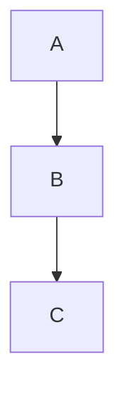

A preamble with **bold**, _italic_, `inline code`, ~~strikethrough~~, a
[link](https://example.com), an , and an autolink
<https://example.com>. Three sentences so the last one is addressable.

Setext Level One
================

Content under a setext heading. Setext uses an underline instead of hashes.

Setext Level Two
----------------

Content under the setext level two.

## ATX level two

An ordered list follows.

1. first ordered item
2. second ordered item
   1. nested ordered child
   2. second nested child
3. third ordered item

An unordered list with nesting and a task list:

- top level bullet
  - nested bullet
    - doubly nested bullet
- another top bullet

- [ ] unchecked task
- [x] checked task

##### Skips to five

| Left | Center | Right |
|:-----|:------:|------:|
| a | b | c |
| dd | ee | ff |

A fenced block with a language:

```python
def f(x):
    return x + 1
```

A fenced block with no language:

```
plain fenced content
second line
```

An indented code block:

    indented line one
    indented line two

### Back to three

> A simple blockquote. It has two sentences.

> A blockquote containing a list:
>
> - quoted bullet one
> - quoted bullet two
>
> And a fenced block:
>
> ```bash
> echo nested
> ```

> Outer quote text.
>
> > Nested inner quote text.
> >
> > > Triple nested quote.

---

# ATX level one arriving late

A mermaid diagram:



***

An HTML block:

<details>
<summary>Click to expand</summary>

Hidden content inside the details element.

</details>

A footnote reference[^1] in a sentence.

[^1]: The footnote definition text.

A reference-style [link][ref] resolved below, plus [mdit] and [spec].

[ref]: https://example.com/reference
[MDIT]: https://github.com/executablebooks/markdown-it-py "The parser"
[ spec ]: https://spec.commonmark.org

A line with a hard break at the end  
and the continuation after the break.

Term
: The definition list body.

###### Final level six

The last paragraph of the document.
